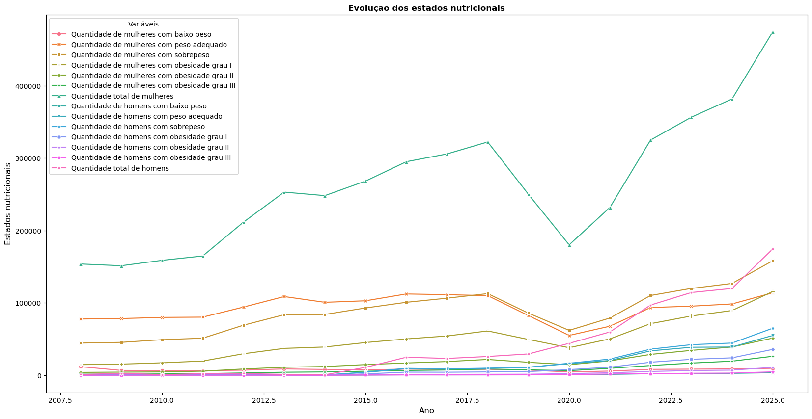

# Estudo de caso com metodologia de métodos quantitativos (Mestrado em Economia Aplicada - UFAL) aos dados do estado nutricional do SISVAN (2008-2025)

> Script em Python que analisa os dados coletados e consolidados pelo SISVAN (Sistema de Vigilância Alimentar e Nutricional) 
> sobre o estado nutricional entre os sexos masculinos e femininos no Brasil entre o período de 2008 - 2025
> para criar uma série de estatísticas descriticas envolvendo as variavéis de sub-nutrição, obesidade de grau I, II e III e et al. 



## Objetivo

Compreender as estatística descritivas envolvendo tendência, dispersão e visualização envolvendo as variavéis de grupamento que são sexo/gênero, raça/cor e escolaridade dos dados do SISVAN

## 🗂️ Dados

- **Fonte:** [SISVAN (Sistema de Vigilância Alimentar e Nutricional)](https://sisaps.saude.gov.br/sisvan/relatoriopublico/index) (dados públicos)
- **Relatórios:**
- **Estado Nutricional**
- **Consumo Alimentar**
- **ANDI - Acompanhamento Nutricional**


## Como funciona

1. Definir: Ano e Mês de Referência / Unidade Geográfica
2. Outros filtros: Região de Cobertura
3. Outros filtros: Acompanhamentos registrados
4. Outros filtros: Raça/cor
5. Outros filtros: Escolaridade


Exemplo do código:

```python
html_mas_2008 = pd.read_html(r'C:\Users\DESKTOP\Desktop\SCRIPT - OBESIDADE\Base\Masculino_2008.xls', encoding='utf-8', header=3, thousands='.', decimal=',')

# Este código está em HTML pois os dados fornecidos pelo SISVAN para Estado nutricional vem como formato .xls, mas possuem uma característica oculta que revela ser HTML
# No VSCODE é possível observar que qualquer base é dada pelo início, como:
# <html xmlns:x="urn:schemas-microsoft-com:office:excel">
# 			<head>
# 				<!--[if gte mso 9]>
# 				<xml>
# 					<x:ExcelWorkbook>
# 						<x:ExcelWorksheets>
# 							<x:ExcelWorksheet>
# 								<x:Name>Relatório</x:Name>
# 								<x:WorksheetOptions>
# 									<x:Print>
# 										<x:ValidPrinterInfo/>
# 									</x:Print>
# 								</x:WorksheetOptions>
# 							</x:ExcelWorksheet>
# 						</x:ExcelWorksheets>
# 					</x:ExcelWorkbook>
# 				</xml>
# 				<![endif]-->
# 			</head><!DOCTYPE html>
# <html>
```

## Ferramentas

- Python 3.13.15
- Imports e pip install's: pandas, statsmodel, scipy, matplotlib, seaborn, lxml
- Jupyter Notebook


## Como executar

```Terminal ou célula 
!pip install pandas
```

Baixe tudo e abra seu Editor de Código, procure a pasta `Script_Estastica_Grupo_3` e execute as células em ordem.

## Autor

**Alexandre Albuquerque** – Economista | Mestrando em Economia Aplicada (UFAL)
- [LinkedIn](https://www.linkedin.com/in/alexandre-albuquerque-1814852a7/) 
- [GitHub](https://github.com/alexandre-albuquerque17)

